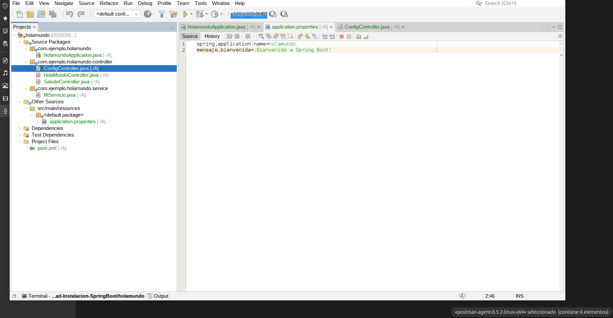
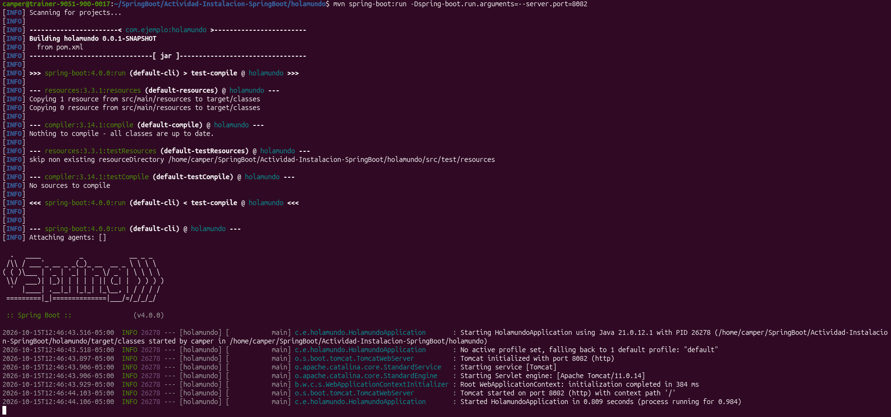
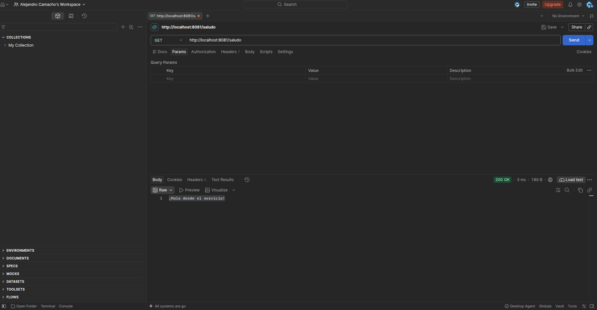

# Actividad práctica: Mi primer proyecto con Spring Boot

**Estudiante:** Alejandro Camacho

Aplicación de consola web desarrollada con Spring Boot y Maven. Incluye tres endpoints REST para practicar controladores, servicios, inyección de dependencias y configuración externa.

## Tecnologías

- Java 17 o superior
- Spring Boot 4.0.0
- Spring Web MVC y Tomcat
- Maven
- NetBeans
- Postman e Insomnia para pruebas HTTP

## Requisitos previos

- JDK instalado
- Maven instalado
- Proyecto descargado o clonado
- Postman e Insomnia para completar las evidencias solicitadas

## Cómo ejecutar el proyecto

Desde la terminal, entra en la carpeta que contiene el archivo `pom.xml` y ejecuta:

```bash
mvn spring-boot:run
```

Por defecto, Spring Boot intenta iniciar en el puerto 8080. En este equipo ese puerto estaba ocupado, por lo que se utilizó el puerto 8082:

```bash
mvn spring-boot:run -Dspring-boot.run.arguments=--server.port=8082
```

Mantén abierta la terminal mientras haces las pruebas. Si usas el puerto 8082, utiliza esa dirección en Postman e Insomnia.

## Endpoints

| Método | URL local (puerto 8082) | Resultado esperado |
|---|---|---|
| GET | `http://localhost:8082/api/hola` | `200 OK` — ¡Hola Mundo desde Spring Boot! |
| GET | `http://localhost:8082/saludo` | `200 OK` — ¡Hola desde el servicio! |
| GET | `http://localhost:8082/config` | `200 OK` — ¡Bienvenido a Spring Boot! |
| POST | `http://localhost:8082/api/hola` | `405 Method Not Allowed`, porque el endpoint solo admite GET |

Si la aplicación se inicia en otro puerto, reemplaza `8082` por el puerto que indique la consola.

## Estructura del proyecto

```text
src/main/java/com/ejemplo/holamundo/
├── HolamundoApplication.java
├── controller/
│   ├── HolaMundoController.java
│   ├── SaludoController.java
│   └── ConfigController.java
└── service/
    └── MiServicio.java

src/main/resources/
└── application.properties
```

- `HolaMundoController`: expone `GET /api/hola`.
- `SaludoController`: expone `GET /saludo` y recibe `MiServicio` mediante inyección de dependencias.
- `ConfigController`: expone `GET /config` y obtiene el mensaje desde la configuración.
- `MiServicio`: proporciona el saludo y se registra en Spring mediante `@Service`.
- `application.properties`: contiene la propiedad `mensaje.bienvenida`.

## Conceptos aplicados

- **`@RestController`:** declara un controlador web que responde a peticiones HTTP.
- **`@GetMapping`:** asocia una ruta con peticiones GET.
- **`@Service`:** registra la clase de servicio como un bean administrado por Spring.
- **Inyección por constructor:** permite que Spring entregue `MiServicio` a `SaludoController` sin crear la instancia manualmente con `new`.
- **`@Value`:** permite leer el valor de `mensaje.bienvenida` desde `application.properties`.

## Evidencias de la actividad

Guarda las capturas dentro de la carpeta `capturas` del proyecto y conserva los nombres indicados abajo. Las imágenes deben ser capturas reales de tu aplicación; no se deben reemplazar por imágenes inventadas.

### 1. Estructura del proyecto en el IDE

Archivo: `01-estructura-proyecto.png`



### 2. Consola con Tomcat iniciado

Archivo: `02-consola-tomcat-started.png`

La captura debe mostrar la línea `Tomcat started on port 8082 (http)` si estás ejecutando la aplicación en ese puerto.



### 3. Pruebas en Postman

- [ ] `GET /api/hola` — guardar como `05-postman-api-hola.png`.
- [ ] `GET /saludo` — guardar como `03-postman-saludo.png`.
- [ ] `GET /config` — guardar como `04-postman-config.png`.

Cada captura debe mostrar la URL, el método GET, el código de estado `200 OK` y la respuesta.




### 4. Pruebas en Insomnia

- [ ] `GET /api/hola` — guardar como `06-insomnia-api-hola.png`.
- [ ] `GET /saludo` — guardar como `07-insomnia-saludo.png`.
- [ ] `GET /config` — guardar como `08-insomnia-config.png`.

Cada captura debe mostrar la URL, el método GET, el código de estado `200 OK` y la respuesta. Insomnia presentó un error gráfico al abrirse en el equipo, así que estas evidencias quedan pendientes hasta conseguir que la aplicación se ejecute correctamente.

### 5. Reto: enviar un método HTTP incorrecto

Envía una petición **POST** a `http://localhost:8082/api/hola`. Como la ruta está declarada para GET, el resultado esperado es `405 Method Not Allowed`.

- [ ] Guardar la captura como `09-405-method-not-allowed.png`.

### 6. Reto: quitar temporalmente `@Service`

1. Abre `MiServicio.java` y comenta o elimina temporalmente la anotación `@Service`.
2. Intenta iniciar la aplicación.
3. Captura el error de arranque que indica que no se encontró un bean de tipo `MiServicio`.
4. **Vuelve a poner `@Service`** y comprueba que la aplicación arranca normalmente.

El mensaje puede ser similar a:

```text
Parameter 0 of constructor in SaludoController required a bean
of type 'MiServicio' that could not be found.
```

- [ ] Guardar la captura como `10-error-sin-service.png`.
- [ ] Verificar que `@Service` quedó restaurado antes de terminar.

## Repositorio y documentación

- **GitHub:** [Actividad-Instalacion-SpringBoot](https://github.com/alejocamacho1210/Actividad-Instalacion-SpringBoot)
- **DeepWiki:** [Abrir el repositorio en DeepWiki](https://deepwiki.com/alejocamacho1210/Actividad-Instalacion-SpringBoot)

Si DeepWiki todavía no muestra el contenido, abre el enlace y sigue el proceso que solicite para indexar el repositorio.

## Pregunta: ¿qué diferencia hay entre `@RestController` y `@Service`?

`@RestController` identifica una clase que atiende solicitudes web y devuelve la respuesta HTTP. `@Service` identifica una clase que contiene lógica de servicio y permite que Spring la registre como un bean.

Spring puede entregar `MiServicio` a `SaludoController` mediante inyección de dependencias. Al iniciar, Spring detecta la anotación `@Service`, crea el bean y lo proporciona al constructor del controlador. Si se elimina la anotación y no existe otra forma de registrar ese bean, Spring no encuentra la dependencia requerida y la aplicación no puede arrancar.

## Lista final de comprobación

- [ ] Confirmar que la aplicación inicia correctamente.
- [ ] Completar las tres capturas de Postman.
- [ ] Completar las tres capturas de Insomnia.
- [ ] Guardar la captura del error 405.
- [ ] Guardar la captura del error al retirar `@Service`.
- [ ] Restaurar `@Service` y comprobar de nuevo el arranque.
- [ ] Revisar que las imágenes estén subidas al repositorio y se vean en este README.
